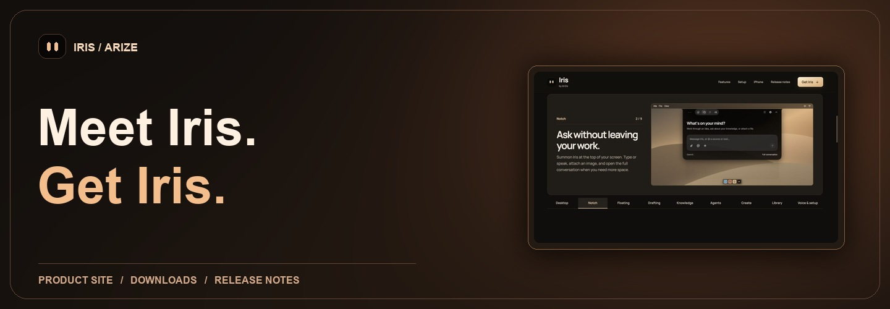
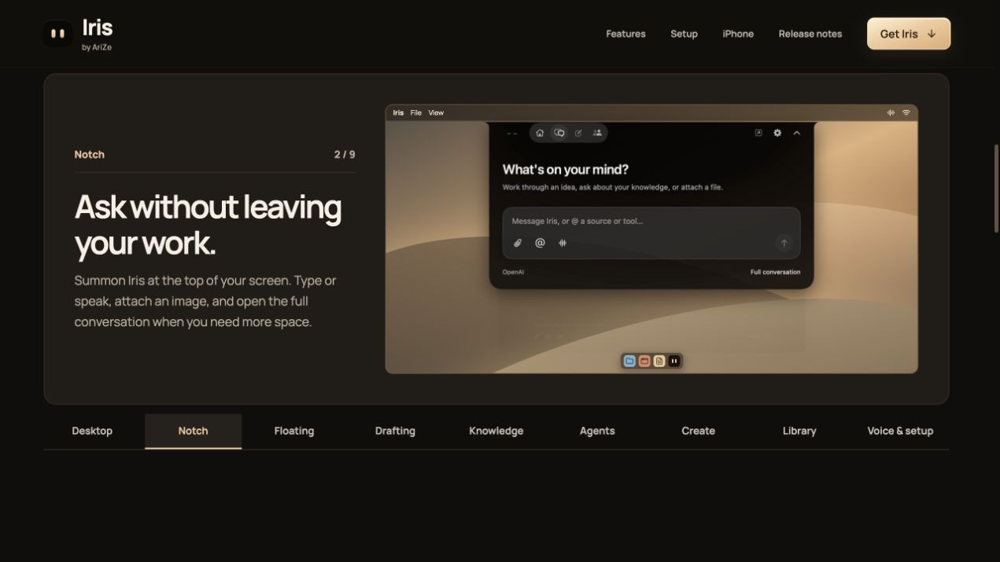
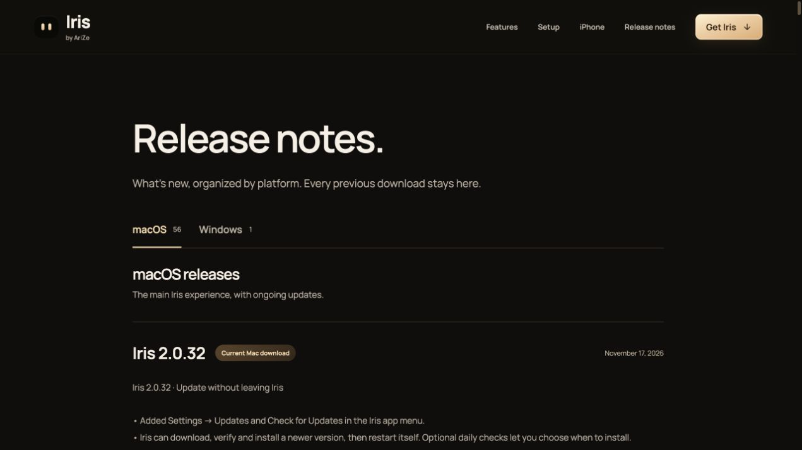

<h1 align="center">Iris Website</h1>

<p align="center">The public home for Iris, from the interactive tour to the latest download.</p>

<p align="center">
  <a href="https://projectiris.lovelyabbey.chatgpt.site/"><strong>Visit the website</strong></a> ·
  <a href="https://projectiris.lovelyabbey.chatgpt.site/download">Downloads</a> ·
  <a href="https://projectiris.lovelyabbey.chatgpt.site/releases">Release notes</a> ·
  <a href="https://github.com/MustafaS22/Project-Iris">App source</a>
</p>

## Explore the site


**Interactive feature tour.** Scroll or choose a feature to see nine Iris workflows, including the desktop app, notch, floating mode, and drafting.



| Platform-aware downloads | Release history |
| :---: | :---: |
|  |  |

## How it fits together

| Part | What it does |
| --- | --- |
| **Product pages** | Introduce Iris, show how it works, and guide visitors through installation on Mac, Windows, or iPhone. |
| **Downloads and release notes** | Suggest the download for the visitor’s device, keep the other platform available, and list older macOS and Windows builds separately. |
| **Release desk** | Lets the team sign in with Google, choose a platform, and publish an installer with its release notes. |
| **Sparkle feed** | Delivers signed macOS releases to Iris’s in-app updater. |

## Run it locally

Node 24 or later is recommended.

```sh
npm ci
npm run dev
```

```sh
npx tsc --noEmit
node --experimental-strip-types tests/platforms.mjs
node --experimental-strip-types tests/appcast.mjs
npm run build
```

The site uses React and Vinext on a Cloudflare Worker. **D1** stores release records and **R2** serves installers. For a separate deployment, start with the [hosting example](.openai/hosting.example.json) and supply your own Google OAuth client, admin email, and session secret as server settings. Production credentials and installer binaries are excluded from this repository. Older static downloads and the iPhone preview need their own assets or URLs.

## Project links

[Report a website issue](https://github.com/MustafaS22/Project-Iris-Website/issues) · [Source manifest](SOURCE_MANIFEST.json) · [Source sync](tools/sync-source.py)

Built by **AriZe**. Third-party assets and dependencies retain their own terms. This repository carries no additional blanket license.
