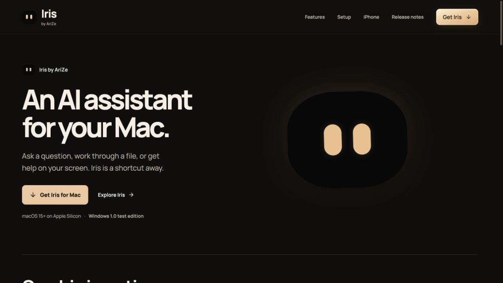
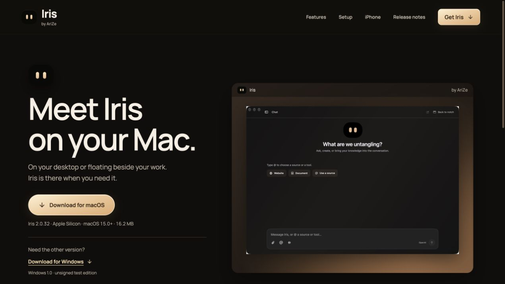

# Iris Website by AriZe

The official Iris website: homepage, device-aware downloads, separate Mac/Windows release histories, Google-authenticated release desk, and signed Sparkle update feed.

[Live website](https://projectiris.lovelyabbey.chatgpt.site) · [App source](https://github.com/MustafaS22/Project-Iris)

## Screenshots

### Homepage

### Interactive feature tour

### Downloads

### Release notes

## Development

Node 24+ is recommended. Run `npm ci`, then `npm run dev`. Type-check with `npx tsc --noEmit`; focused checks use `node --experimental-strip-types tests/platforms.mjs` and `node --experimental-strip-types tests/appcast.mjs`. Build with `npm run build`.

Production is a Cloudflare Worker with D1 binding `DB` and R2 binding `BUCKET`. Configure your own Google OAuth client, admin email and session secret as server environment variables. Real runtime secrets and production hosting identity are not included. The fallback admin address in this public source is a placeholder. Create your own hosting project from `.openai/hosting.example.json`; preserve the existing owner's deployment when using the internal working copy.

Generated installers (`.dmg`, `.exe`, `.ipa`) and dependency/build folders are not source files and are excluded. Restore desired legacy/iPhone download assets separately or update their URLs; current Mac/Windows releases are served from R2 by the release desk. Existing public downloads remain on the live website.

## Maintenance

This repository is a public source mirror. After publishing a website update, synchronize the tested source, audit, commit and push it here. `SOURCE_MANIFEST.json` identifies the snapshot; `tools/sync-source.py` is the repeatable maintainer tool. App code lives in the separate Project-Iris repository.

Developed by **AriZe**. Third-party notices retain their original terms; no additional blanket source license is granted.
